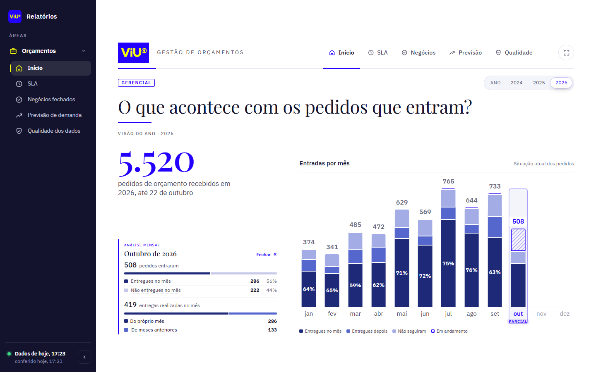

# Revisão do relatório gerencial — 23/10/2026

O painel mantém a identidade VIU e o histórico anual, com extratos disponíveis nos seis meses mais recentes. A apresentação distingue pedidos recebidos de entregas realizadas, sem exigir procurar a produção de outubro na coluna de setembro.

## Alterações implementadas

**Refinamento de navegação:** mantido apenas tipo de input na legenda cinza e no gráfico; situação acessível na consulta do mês. Total anual com descrição e período separados. Extrato menor e elevado, com tooltip quantitativo de “Sem entrega no mês”: entregues depois, não seguiram e ainda em aberto. Em outubro: **0 + 74 + 148 = 222** na fotografia auditada. As seis composições reconciliam; os 54 testes continuam aprovados. Tooltip conferido dentro da tela em 1261×638 com menu aberto e em 390×844. [Tela atualizada](evidencias/2026-10-23/extrato-status-outubro.png).

- Hierarquia entre visão do ano, análise mensal e gráfico; mantidos azul, amarelo, Playfair Display e IBM Plex Sans.
- Legenda de situação/tipo com fundo cinza e tipografia compacta, conforme último ajuste solicitado. Extrato com números alinhados, duas barras de composição, legenda do gráfico e fechamento explícito.
- Entrada: entregues no próprio mês e **não entregues naquele mês**. Este segundo grupo inclui entregues depois, não seguidos e ainda em andamento; a definição está no tooltip.
- Saída: primeiras entregas realizadas no mês, separadas entre pedidos do próprio mês e de meses anteriores. O tooltip discrimina cada mês e ano de origem.
- Janela móvel de seis meses, incluindo o parcial e atravessando anos. Na fotografia examinada: maio–outubro de 2026. Meses antigos mantêm a fotografia simples e os totais anuais; extrato antigo também é bloqueado por URL.
- Tooltips disponíveis por mouse, foco e toque; Escape fecha. Gaveta móvel ignora controles inertes e libera o conteúdo ao retornar ao desktop.
- Página de regras do SLA preenchida. O texto da base identifica a mediana e o mês de entrada do pedido.
- Falhas de carga respeitam retentativa; contratos rejeitam contagens inválidas, composição inconsistente e históricos descontínuos. Carga anterior é preservada quando disponível.
- Em produção, a recarga não depende de trabalho de fundo durante ausência de requisições. O ambiente local mantém a opção assíncrona.
- Cobertura temporal usa processamento no fuso de São Paulo, inclusive dias sem pedidos. Extrato com entrada divergente da coluna fica temporariamente indisponível.
- Avisos consideram falha/atraso da fonte secundária; link de nova tentativa da página inicial corrigido.

## Validação dos cálculos

Consultas somente de leitura no projeto `gglobo-viu-dados-hdg-prd`, identidade `caio.barroso@viu.com.br`, verificados durante a auditoria. Dry runs e limite de 250 MiB por consulta. Nenhuma alteração no GCP.

| Verificação | Resultado |
|---|---:|
| Integridade do SLA | 19/19 verificações aprovadas |
| Entrada diária, incluindo reconciliações com Silver | 53/53 aprovadas |
| Fluxo mensal | 17/17 aprovadas |
| Etapas fechadas conferidas por calendário independente | 11.759 |
| Divergências de faixa do SLA antes → depois | 1 → 0 |
| Maior diferença de horas entre site corrigido e cálculo independente | 0 |
| Etapas com diferença superior a um minuto contra a regra da Gold | 0 |
| Extratos recentes reconciliados com saídas da tabela diária | 6/6 |

**Defeito corrigido:** um caso de exatamente 16 horas era somado como `16.000000000000004` e saía da faixa de até 16 horas. Agora os intervalos são somados em microssegundos inteiros e convertidos ao final, sem tolerância artificial.

Na fotografia de 23/10, janeiro–setembro tem 2.425 pedidos com primeira entrega: mediana de **15,20537 horas úteis**, **2,87102 dias corridos** e **1.276 em até 16 horas**. A Gold histórica usa expediente com almoço: sua comparação utilizou essa mesma regra, separadamente da regra sem almoço do site. A diferença máxima contra os valores arredondados da Gold foi aproximadamente 19 segundos.

| Mês | Entraram | Entregues no próprio mês | Não entregues naquele mês | Entregas realizadas | De meses anteriores |
|---|---:|---:|---:|---:|---:|
| Maio | 629 | 449 | 180 | 504 | 55 |
| Junho | 569 | 411 | 158 | 479 | 68 |
| Julho | 765 | 575 | 190 | 672 | 97 |
| Agosto | 644 | 489 | 155 | 565 | 76 |
| Setembro | 733 | 460 | 273 | 515 | 55 |
| Outubro, parcial | 508 | 286 | 222 | 419 | 133 |

Os 133 de outubro são **131 de setembro, 1 de agosto e 1 de março**. Os 55 de setembro são **50 de agosto, 1 de maio, 2 de fevereiro e 2 de janeiro**. Saída significa primeira entrega, não retrabalho.

Os jobs processaram **31.738.343 bytes** e registraram **136.314.880 bytes faturáveis**, sujeitos a arredondamento/cache do BigQuery. Isso não é apuração da fatura em dinheiro. O pós-teste reutilizou snapshots locais sem novas consultas.

## Testes e limites

**54 testes locais aprovados**, cobrindo cálculos, limite exato, virada de ano, janela de extratos, origem das entregas, carga, falhas e rotas. Permanece um aviso de depreciação de Starlette/httpx.

Verificação no navegador: desktop 1440×900 e 1261×638, celular 390×844 com toque e largura 320×640; sem rolagem horizontal nas telas verificadas. Na tela 1261×638 com menu aberto, todos os tooltips de situação/tipo e dos extratos de setembro/outubro ficaram dentro da área visível; extrato sem corte inferior. Foram exercitados teclado/Escape, toque, links recentes e bloqueio de meses antigos. Sem erros de JavaScript nas navegações medidas. Não equivale a homologação com todos os navegadores ou leitores de tela.

As verificações confirmam a consistência da fotografia auditada e das regras documentadas. A qualidade do preenchimento original no Monday depende da operação; o histórico pode mudar em novas cargas. Silver/Gold reconciliaram; não foi necessário um novo scan integral da Bronze.

Autenticação de produção ainda não está implementada e a trava contra `AUTH=off` em produção permanece. Não houve deploy nem homologação de Cloud Run, IAM ou múltiplas instâncias. Negócios fechados depende de fonte própria; previsão continua exemplo de desenvolvimento, não previsão operacional. A seção de qualidade mantém a decisão anterior do projeto.

Evidências e IDs dos jobs: [validacao_2026-10-23.json](validacao_2026-10-23.json). Auditoria reproduzível: [auditar_relatorio.py](../../_descartados/2026-10-27/tools/auditar_relatorio.py).

Backup: `C:\Users\CCMB\AppData\Local\Codex\Backups\PPD-AGENCIAMENTO-SLA-20261023-174152`. O `.env` não foi alterado nem incluído no backup.
